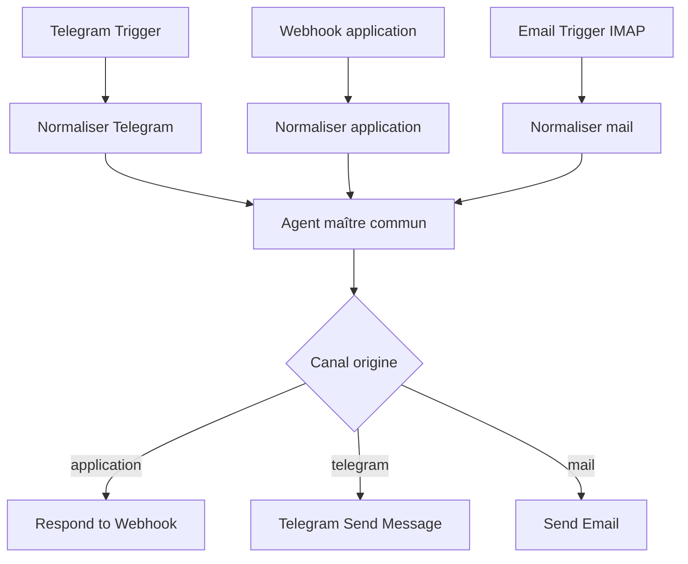
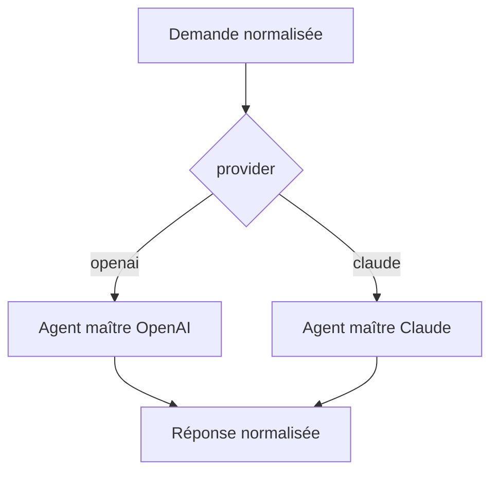

# Ajouter l’application à un agent maître n8n existant

## Oui, plusieurs entrées sont possibles

Un workflow n8n peut contenir plusieurs déclencheurs. Une exécution démarre par **un seul** déclencheur : Telegram, le webhook de l’application ou l’arrivée d’un mail. Chaque branche met ensuite les informations au même format avant d’appeler le même traitement central.



Il n’est pas nécessaire de mettre un nœud Merge entre les entrées. Relier les branches normalisées au même nœud suffit : une seule branche s’exécute à la fois.

### Point particulier de Telegram

Telegram n’autorise qu’un webhook actif par bot. Il faut donc conserver **un seul Telegram Trigger actif pour ce bot**. Ajouter Webhook et Email Trigger dans ce même workflow ne pose pas de conflit. En revanche, ne placez pas le même bot dans deux workflows Telegram actifs.

## Format commun conseillé

Après chaque déclencheur, un nœud Edit Fields ou Code produit :

```json
{
  "source": "app | telegram | email",
  "conversationKey": "identifiant stable du fil",
  "text": "demande de l’utilisateur",
  "attachments": [],
  "provider": "openai | claude",
  "replyTarget": "destination de la réponse"
}
```

Clés de conversation conseillées :

- application : `app:<conversationId>` ;
- Telegram : `telegram:<message.chat.id>` ;
- mail : `email:<adresse>:<thread-id>` quand un identifiant de fil est disponible.

Cela empêche l’historique d’un canal de se mélanger avec un autre.

## Choisir OpenAI ou Claude

L’application envoie déjà `provider: "openai"` ou `provider: "claude"`. Pour Telegram ou le mail, vous pouvez choisir un fournisseur par défaut, ou interpréter un préfixe comme `/claude` ou `[openai]` pendant la normalisation.

Placez ensuite un nœud IF ou Switch avant le cerveau de l’agent :



Dans n8n, le modèle est connecté au nœud AI Agent comme un sous-nœud. La solution la plus lisible consiste donc à avoir deux nœuds racine « Agent maître », avec les mêmes instructions et les mêmes outils, mais chacun relié à son modèle. Une autre solution consiste à appeler deux sous-workflows « Maître OpenAI » et « Maître Claude ».

## Réutiliser l’agent maître sans dupliquer les entrées

La structure la plus simple à maintenir comporte deux workflows :

1. **Entrées et sorties** : Telegram, Webhook, Email, normalisation et réponse au bon canal.
2. **Cœur agent maître** : commence par Execute Sub-workflow Trigger, choisit le fournisseur, appelle les sous-agents et renvoie un objet `{ answer, provider }`.

Dans le premier workflow, ajoutez `Execute Sub-workflow`, sélectionnez le workflow du cœur et attendez la fin de son exécution. Ce découpage permet d’ajouter un autre canal plus tard sans recopier la batterie d’agents.

## Attention aux réponses

- `Respond to Webhook` fonctionne uniquement pendant une exécution lancée par le Webhook.
- Une exécution Telegram doit finir par Telegram « Send Message ».
- Une exécution mail doit finir par le nœud d’envoi de mail choisi.
- Pour un traitement très long, l’application devrait passer à un mécanisme asynchrone. Le prototype attend jusqu’à quatre minutes et conserve une erreur relançable si n8n ne répond pas.

## Abonnements et accès aux modèles

Un abonnement à l’interface ChatGPT ou Claude ne constitue généralement pas un crédit API pour n8n. Le workflow fourni utilise des appels API et demande donc des identifiants API avec facturation associée, ou les crédits d’une passerelle IA proposée par votre installation n8n. Aucun secret n’est placé dans les fichiers du kit.
